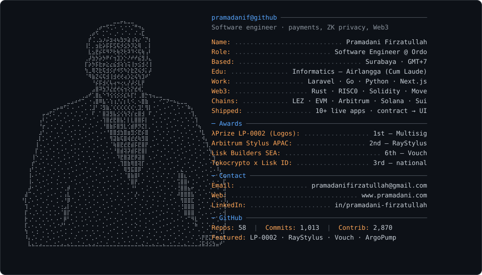

<picture>
  <source media="(prefers-color-scheme: dark)" srcset="dark_mode.svg">
  <source media="(prefers-color-scheme: light)" srcset="light_mode.svg">
  
</picture>

<strong>More</strong> — projects, stack, links

 

**Pramadani Firzatullah** — Software Engineer at PT Ordo Teknologi Karya · Surabaya (GMT+7)  
Applied Informatics Engineering — Airlangga University (Cum Laude, GPA 3.66)

Payments backends at work, ZK privacy and Web3 on the side. Contract to UI.

### Highlights
- **1st** — λPrize LP-0002, Logos Network (2026) — [Private M-of-N Multisig](https://github.com/pramadanif/lp-0002-private-multisig) — shielded approvals on LEZ with RISC0 proofs · [demo](https://youtu.be/7gRweVxWEL4)
- **2nd** — Arbitrum Stylus Mini Hackathon Asia Pacific (2025) — [RayStylus](https://raystylus.vercel.app) — on-chain ray tracer in Rust/WASM
- **6th** — Lisk Builders Challenge 3 SEA (2025) — [Vouch](https://www.vouch.my.id) — hybrid decentralized escrow
- **3rd nationally** — Tokocrypto x Lisk DApps Idea Competition (2022)
- Also: Reactive Network (Albatroz Sentinel), Walrus/Sui (SourceNet, Worm), Stellar, Aptos (ArgoPump), Colosseum Frontier (Redact)

### At work
- Payment products on Laravel + PostgreSQL, ~1M users, deployed on AWS EC2
- Go merchant backend for BCA SNAP Virtual Account
- [Notulen](https://notulen.ordoapps.com) — meeting audio to minutes with Gemini + OpenRouter
- [Ordo Land](https://land-finder.ordoapps.com) — land intelligence globe with an AI site-search agent

### Stack (short)
Next.js · React · TypeScript · Laravel · PHP · Go · Python · Node · Rust · RISC0 · Solidity · Move · PostgreSQL · Docker  
Chains: LEZ · EVM · Arbitrum · Solana · Aptos · Sui · Stellar · Celo · Lisk

### Links
- Web: [pramadani.site](https://www.pramadani.site)
- LinkedIn: [pramadani-firzatullah](https://www.linkedin.com/in/pramadani-firzatullah)
- Email: pramadanifirzatullah@gmail.com

